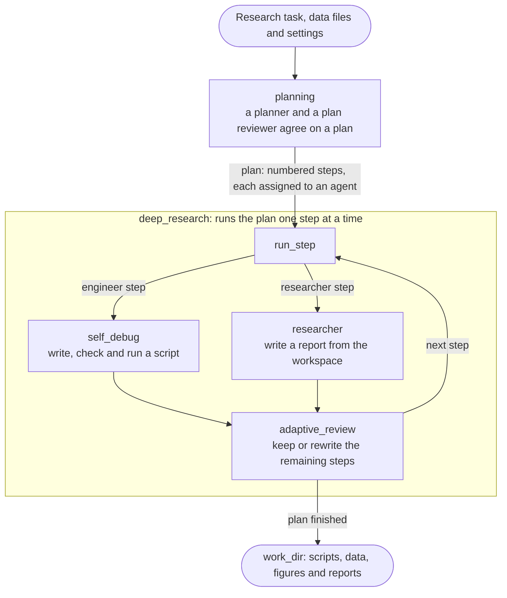
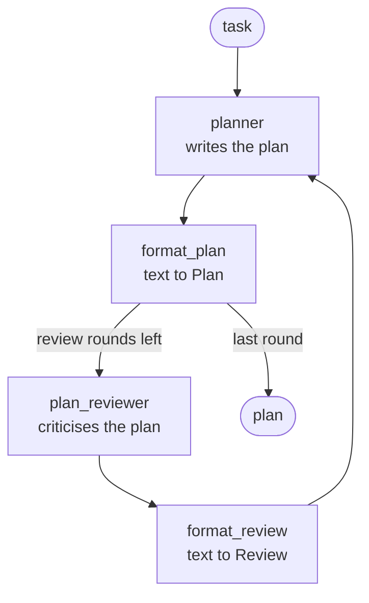
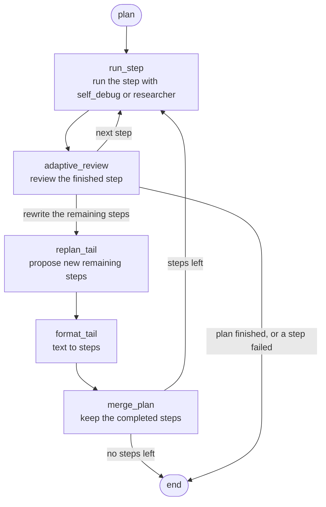
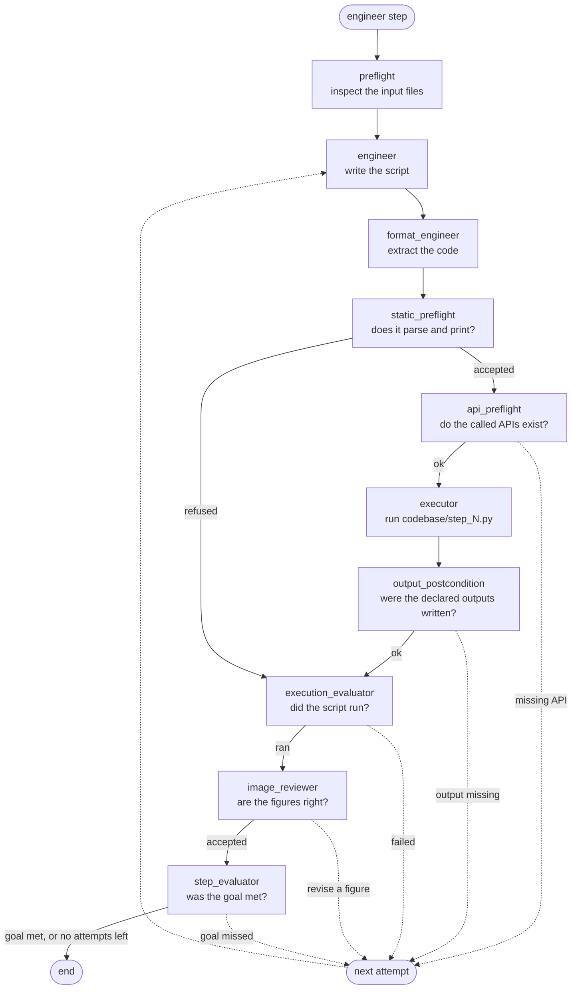
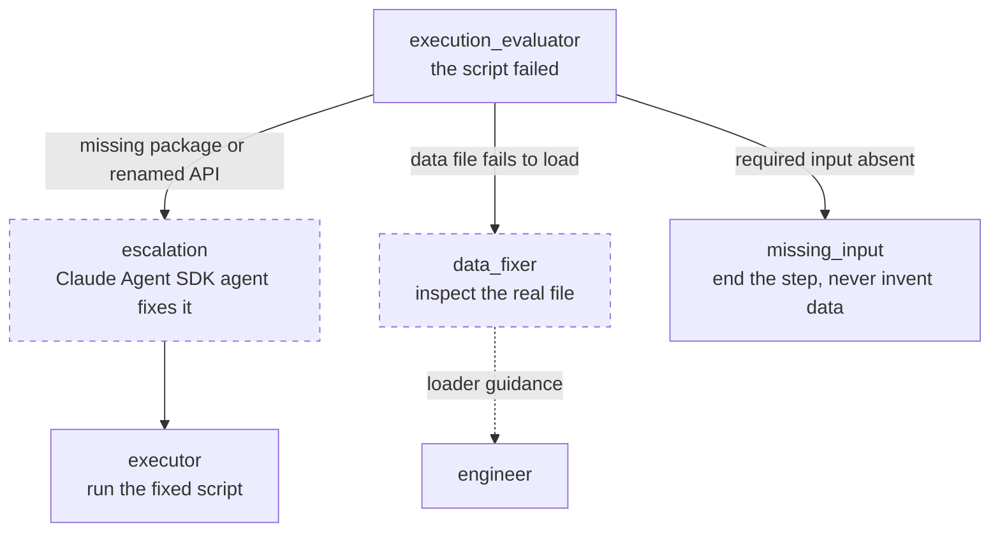
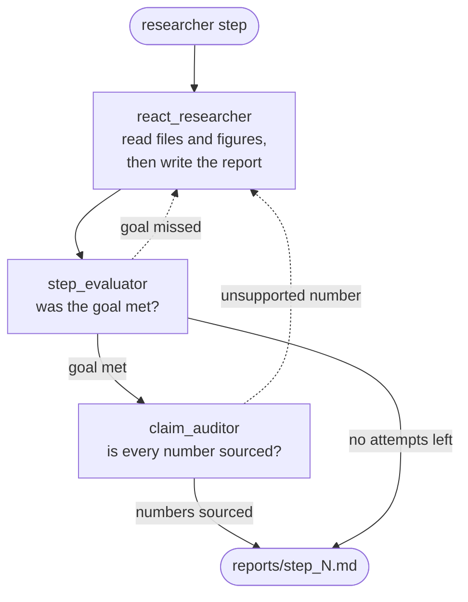

# CMBAgent

[](LICENSE)
[](https://arxiv.org/abs/2507.07257)
[](pyproject.toml)

CMBAgent is an agentic research harness. Given a research task and its data, it plans the analysis, has language-model agents write and run the Python code for each step, checks the results, and writes a report. It is built on [LangGraph](https://github.com/langchain-ai/langgraph), and the Python package is `cmbagent_lg`. The name comes from the project's origins in cosmic microwave background analysis; the harness works in any field whose analyses can be written in Python.

CMBAgent is the analysis engine of [Denario](https://github.com/AstroPilot-AI/Denario), and it won first place at the NeurIPS 2025 [FAIR Universe Competition](https://fair-universe.lbl.gov/). Demo videos are on [YouTube](https://www.youtube.com/@cmbagent), and questions are welcome on [Discord](https://discord.gg/UG47Yb6gHG).

> [!NOTE]
> Since 16 November 2026, `main` holds `cmbagent_lg`, the LangGraph implementation; the branch `lg` holds the same code. The earlier implementation, built on [AG2](https://github.com/ag2ai/ag2) and published on PyPI as [`cmbagent`](https://pypi.org/project/cmbagent/), is on the branch [`ag2`](https://github.com/CMBAgents/cmbagent/tree/ag2).

## Overview



A run has two phases. The `planning` graph turns the task into a plan: a list of steps, each assigned to the **engineer**, who writes and runs code, or to the **researcher**, who writes text. The `deep_research` graph then runs the steps in order. An engineer step goes through `self_debug`, which writes a script, runs it, and retries until two evaluators accept the result. A researcher step goes through `researcher`, which writes a report from the files in the workspace and has its numbers checked against them. After each step, an adaptive review can rewrite the steps that have not run yet, and a checkpoint is saved so that an interrupted run can resume.

Each role can use its own model and provider. By default every role uses `gemini-3.1-flash-lite`, except the figure reviewer, which uses `gemini-3.1-pro-preview`.

## Installation

```bash
python3 -m venv .venv
source .venv/bin/activate
pip install "cmbagent_lg @ git+https://github.com/CMBAgents/cmbagent"
```

From a clone of this repository, use `pip install -e .` instead. Two extras are available: `escalation` (the Claude Agent SDK, for the optional escalation node) and `ocr` (Mistral OCR).

The default models need `GOOGLE_API_KEY`. A role on an OpenAI or Anthropic model needs `OPENAI_API_KEY` or `ANTHROPIC_API_KEY`, and the package `langchain-openai` or `langchain-anthropic`. Tracing needs the `LANGFUSE_*` variables described in [Tracing with Langfuse](#tracing-with-langfuse). The file [`.env.example`](.env.example) lists them; copy it to `.env`.

> [!WARNING]
> The engineer's scripts run as subprocesses of the Python interpreter that runs CMBAgent, in the run's working directory, with your user's permissions and your environment variables, API keys included. Install the packages that the analyses need in that environment, for example `pip install numpy scipy matplotlib pandas`, and run CMBAgent in a container or a virtual machine when the task or the data are not trusted.

## Quick start

```python
from cmbagent_lg import PlanContext, graph as planning_graph, deep_research_graph, save_final_plan

ctx = PlanContext(
    main_task=(
        "Simulate 200 noisy measurements of a damped harmonic oscillator. "
        "Fit its frequency and damping rate with uncertainties, and plot the data with the fit."
    ),
    maximum_number_of_steps_in_plan=3,
)

plan = planning_graph.invoke({}, context=ctx)["current_plan"]
save_final_plan(plan, "runs/oscillator")

result = deep_research_graph.invoke({"plan": plan, "work_dir": "runs/oscillator"}, context=ctx)
for outcome in result["step_outcomes"]:
    print(outcome["step_number"], outcome["fulfilled"], outcome["attempts"])
```

The scripts, data, figures and reports are written under `runs/oscillator/` (see [Working directory](#working-directory)). For a task with input data, place the files in `data/` inside the working directory before the run, or name them by absolute path in `main_task`. To mix providers, give each role its own model; the provider follows from the model name (`gemini-*` Google, `gpt-*` and `o1`, `o3`, `o4` OpenAI, `claude-*` Anthropic):

```python
ctx = PlanContext(
    main_task="...",
    planner_model="gemini-3.5-flash",
    engineer_model="gpt-5.4",
    researcher_model="claude-sonnet-4-6",
)
```

### Resuming a run

`deep_research` writes `logs/deep_research_run.json` after every step. To resume after a crash, start again from the first step that did not complete:

```python
import json

checkpoint = json.load(open("runs/oscillator/logs/deep_research_run.json"))
resume_at = max(o["step_number"] for o in checkpoint["outcomes"] if o["fulfilled"]) + 1
deep_research_graph.invoke(
    {"plan": plan, "work_dir": "runs/oscillator", "step_index": resume_at,
     "step_summaries": checkpoint["step_summaries"][:resume_at - 1],
     "step_outcomes": checkpoint["outcomes"][:resume_at - 1]},
    context=ctx,
)
```

## The four graphs

The diagrams below show the nodes and edges of the compiled graphs; dotted arrows are retries. A node named `format_*` converts the free text of the node before it into a typed Pydantic object with `with_structured_output`.

### `planning`



`num_rounds` (default 2) sets the number of review cycles, so the planner writes `num_rounds + 1` versions of the plan. The plan has at most `maximum_number_of_steps_in_plan` steps (default 5), and the formatter only accepts agents listed in `available_agents` (by default the engineer and the researcher).

### `deep_research`



`run_step` runs one step through `self_debug` (engineer) or `researcher`, and passes it a summary of the earlier steps: their code, their printed output, and a manifest of the files in the working directory. Only the last `carryover_recent_full` steps (default 3) are passed in full; older steps are reduced to a one-line header, and the agents can still open their files.

`adaptive_review` (on by default, `adaptive_planning`) looks at each finished step and can rewrite the steps that have not run yet; completed steps never change. When a step fails after all its attempts, the run continues with rewritten remaining steps if a rewrite is still allowed, and stops otherwise. A run makes at most `max_adaptations` rewrites (default 3).

### `self_debug`: engineer steps



The code gate, `execution_evaluator`, has three more exits for failures that another attempt would not fix; the first two are optional:



Two model gates decide the outcome. `execution_evaluator` judges whether the script ran, and `step_evaluator` judges whether the step's goal was met; a script that ran but returned a wrong result, such as a fit that stayed at its initial guess, is a goal miss. Every arrow back to the engineer uses one of the step's `max_n_attempts` attempts (default 3); when none are left, the step ends instead. Figure revisions are also limited by `max_vlm_review_attempts` (default 2).

The other nodes are checks that make no model call, except the intent gate in `preflight`:

| Node | Check | Setting |
| --- | --- | --- |
| `preflight` | Inspects the input files before the first attempt (delimiter, columns, HDF5 keys, dtypes) and gives the facts to the engineer. When no input file is found, one classifier call, the intent gate, decides whether the step needed input. | `enable_preflight`, `enable_intent_gate` (on) |
| `static_preflight` | Refuses a script that does not parse, prints nothing, or loads a bundled demo dataset instead of the provided data. | always on |
| `api_preflight` | Checks every third-party name the script uses against the installed packages, and returns the real API to the engineer before running. | `enable_api_preflight` (on) |
| `output_postcondition` | Sends the script back when a run finished without writing an output file that the step declared. | always on |
| `missing_input` | Ends the step when a required input file does not exist, so that the engineer does not invent the data. | `safe_loading`, `enable_intent_gate` (on) |

The dashed nodes are optional. `data_fixer` (`enable_data_fixer`, off) inspects a data file that fails to load, down to its bytes or HDF5 tree, and gives the engineer loader guidance. `escalation` (`enable_escalation`, off) hands a missing package or a renamed API once to a Claude Agent SDK agent, with a budget of US$0.50. With `vlm_enabled=False`, a script that ran goes straight to `step_evaluator`.

### `researcher`: researcher steps



The default writer, `react_researcher` (`researcher_mode="react"`), is a ReAct loop with three read-only tools, `list_workspace`, `read_file` and `view_image`, confined to the working directory. It can make up to `researcher_max_tool_calls` tool calls (default 6, plus one per earlier step) before writing, so it can quote a value that an earlier step saved to a file without printing it. `step_evaluator` grades the report against the step's requirements, and `claim_auditor` (`claim_audit_enabled`, on) checks each number in it against the files and printed outputs. With `researcher_mode="plain"`, the writer is the `researcher` node, which writes the report in one call from the earlier steps' printed output.

The highest-numbered report that passed, `reports/step_N.md`, is the final report of the run; Denario uses it as `results.md`.

### Working directory

```
work_dir/
├── codebase/   step_N.py, step_N.log, step_N_failure_K.py (failed attempts)
├── data/       files written by the scripts
├── reports/    step_N.md (researcher steps)
└── logs/       verdicts, data manifests, figure reviews, researcher tool calls,
                deep_research_run.json (the checkpoint)
```

## Configuration

All settings are fields of `PlanContext`, passed to every graph as `context=`. The main ones:

| Setting | Default | Effect |
| --- | --- | --- |
| `main_task` | required | The research task, in plain text. |
| `maximum_number_of_steps_in_plan` | 5 | Maximum number of steps in the plan. |
| `num_rounds` | 2 | Plan review cycles. |
| `planner_model`, `plan_reviewer_model`, `engineer_model`, `researcher_model`, `evaluator_model`, `formatter_model` | `gemini-3.1-flash-lite` | Model of each role. |
| `vlm_model` | `gemini-3.1-pro-preview` | Vision model of the figure reviewer. |
| `max_n_attempts` | 3 | Attempts per step, shared by all retry paths. |
| `code_execution_timeout` | 120 | Seconds before a running script is stopped. |
| `vlm_enabled` | `True` | Figure review in `self_debug`, and figures shown to the researcher. |
| `researcher_mode` | `"react"` | `"react"` for the ReAct writer, `"plain"` for the single-call writer. |
| `claim_audit_enabled` | `True` | Number checks on each report. |
| `adaptive_planning` | `True` | Rewriting of the remaining steps after each step. |
| `carryover_recent_full` | 3 | Earlier steps passed in full to the next step. |
| `enable_data_fixer`, `enable_escalation` | `False` | Optional nodes of `self_debug`. |

With Gemini 3 models, the engineer runs at temperature 0.2 with thinking level `high`, the planner and the researcher at temperature 1.0 with thinking level `low`, the reviewers and evaluators at temperature 0.4 with thinking level `low`, and the formatters at temperature 0. The full list of settings, with comments, is in [`cmbagent_lg/context.py`](cmbagent_lg/context.py).

## Tracing with Langfuse

[Langfuse](https://langfuse.com) records every model call of a run, including the formatter calls, tagged with the name of its node. Set the keys of a Langfuse project and the URL of the server that issued them:

```bash
LANGFUSE_PUBLIC_KEY=pk-lf-...
LANGFUSE_SECRET_KEY=sk-lf-...
LANGFUSE_BASE_URL=https://cloud.langfuse.com   # read by the Langfuse SDK; or the URL of a self-hosted server
LANGFUSE_HOST=https://cloud.langfuse.com       # same value, read by other tools
```

Then pass the callbacks to each graph:

```python
from cmbagent_lg.tracing import langfuse_callbacks

result = deep_research_graph.invoke(state, context=ctx, config={"callbacks": langfuse_callbacks()})
```

`langfuse_callbacks()` returns an empty list, with a warning, when the keys are not set. A key pair works only on the server that issued it: Langfuse Cloud rejects the keys of a self-hosted project with a 401 error, and the traces are lost without any other sign. After a run, `cmbagent-lg-cost <trace_id or work_dir>` prints the cost, tokens and latency of each agent.

## Examples

| Script | Content |
| --- | --- |
| [`examples/run_planner_review.py`](examples/run_planner_review.py) | Planning only. |
| [`examples/run_self_debug_csv_plot.py`](examples/run_self_debug_csv_plot.py) | One engineer step that writes a CSV file and a plot. |
| [`examples/run_self_debug_lorenz.py`](examples/run_self_debug_lorenz.py) | One engineer step that plots the Lorenz attractor. |
| [`examples/run_deep_research_simple.py`](examples/run_deep_research_simple.py) | A minimal run from task to report. |
| [`examples/run_deep_research.py`](examples/run_deep_research.py) | A run with several engineer steps. |
| [`examples/react_demo.py`](examples/react_demo.py) | A ReAct loop, and the effect of the temperature on it. |
| [`examples/smoke_test_keys.py`](examples/smoke_test_keys.py) | A check of the API keys in `.env` against each provider. |

The examples take an optional working directory, for example `python examples/run_deep_research.py runs/demo`. It is cleared before each run unless `KEEP_WORK_DIR=1` is set.

## Repository layout

```
cmbagent_lg/
├── context.py        PlanContext: every run setting
├── llms.py           chat_model(model, role): the provider from the model name, the defaults of each role
├── persistence.py    working directory, plan and checkpoint files
├── tracing.py        Langfuse callbacks
├── cli.py            cmbagent-lg-cost
├── planning/         planner and plan reviewer
├── deep_research/    run_step, adaptive review and replanning
├── self_debug/       engineer, executor, evaluators and the pre- and post-run checks
├── researcher/       report writers, step evaluator and claim auditor
├── vlm/              figures attached to prompts, and the figure reviewer
└── ocr.py            PDF to markdown with Mistral OCR (extra `ocr`)
examples/             runnable scripts
tests/                test suite (python -m pytest tests)
```

## Citation

```bibtex
@software{CMBAGENT_2025,
  author = {Boris Bolliet},
  title = {CMBAGENT: Open-Source Multi-Agent System for Science},
  year = {2025},
  url = {https://github.com/CMBAgents/cmbagent},
}

@misc{xu2025opensourceplanning,
  title = {Open Source Planning \& Control System with Language Agents for Autonomous Scientific Discovery},
  author = {Licong Xu and Milind Sarkar and Anto I. Lonappan and Íñigo Zubeldia and Pablo Villanueva-Domingo and Santiago Casas and Christian Fidler and Chetana Amancharla and Ujjwal Tiwari and Adrian Bayer and Chadi Ait Ekiou and Miles Cranmer and Adrian Dimitrov and James Fergusson and Kahaan Gandhi and Sven Krippendorf and Andrew Laverick and Julien Lesgourgues and Antony Lewis and Thomas Meier and Blake Sherwin and Kristen Surrao and Francisco Villaescusa-Navarro and Chi Wang and Xueqing Xu and Boris Bolliet},
  year = {2025},
  eprint = {2507.07257},
  archivePrefix = {arXiv},
  primaryClass = {cs.AI},
  url = {https://arxiv.org/abs/2507.07257},
}

@misc{Laverick:2024fyh,
  author = {Laverick, Andrew and Surrao, Kristen and Zubeldia, Inigo and Bolliet, Boris and Cranmer, Miles and Lewis, Antony and Sherwin, Blake and Lesgourgues, Julien},
  title = {Multi-Agent System for Cosmological Parameter Analysis},
  eprint = {2412.00431},
  archivePrefix = {arXiv},
  primaryClass = {astro-ph.IM},
  year = {2024},
}
```

## License

MIT; see [LICENSE](LICENSE). The project is funded by the [Cambridge Centre for Data-Driven Discovery Accelerate Programme](https://science.ai.cam.ac.uk).
